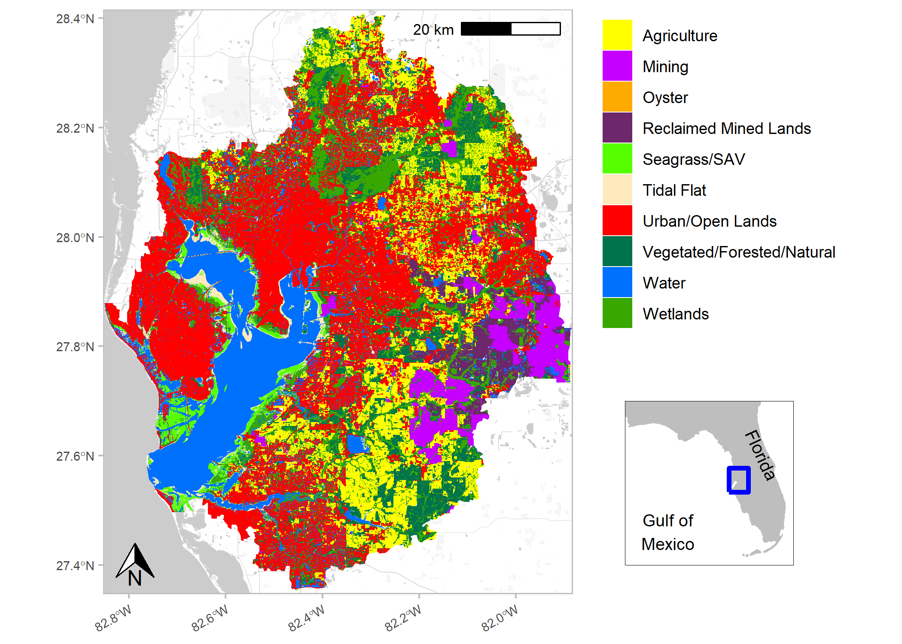

```{=html}
<style>
:root { --tbep-teal:#00806E; --tbep-blue:#2b6b8f; }
.quarto-title-block .quarto-title .title { color: var(--tbep-blue); }
h2 { border-bottom: 2px solid var(--tbep-teal); padding-bottom: .25rem; margin-top: 2.2rem; }
h3 { color: var(--tbep-blue); margin-top: 1.6rem; }
.callout, blockquote { border-left: 4px solid var(--tbep-teal); }
figure img { border: 1px solid #e3e3e3; border-radius: 4px; }
figcaption { font-size: .85rem; color: #555; }
.provenance { font-size: .8rem; color: #666; background:#f6f8f8; border-left:3px solid var(--tbep-teal);
              padding:.4rem .7rem; margin:.3rem 0 1.6rem; border-radius:0 4px 4px 0; }
.provenance code { background:#eef2f2; }
.headline { background:#eef6f4; border:1px solid #cfe5df; border-radius:6px; padding:.8rem 1rem; }
.table-scroll { max-height: 480px; overflow:auto; font-size:.8rem; border:1px solid #e3e3e3; border-radius:4px; }
.table-scroll table { margin:0; }
.table-scroll thead th { position:sticky; top:0; background:#00806E; color:#fff; font-weight:600; }
</style>
```

This page is the web companion to the **2027 Reasonable Assurance (RA) Update** prepared by the
Tampa Bay Estuary Program (TBEP) and the Tampa Bay Nitrogen Management Consortium (NMC) for the
Florida Department of Environmental Protection (FDEP). It presents the narrative, figures, and
tables of the RA Update for the **2022–2026 reporting period**, with each figure and table linked
back to the analysis code that produces it in this repository,
[`tbep-tech/reasonable-assurance-analysis`](https://github.com/tbep-tech/reasonable-assurance-analysis).

::: {.callout-note collapse="false"}
## Reproducibility

Figures and tables are generated programmatically, not hand-edited. Run `R/dat_proc.R` (data
assembly) → `R/figs.R` (figures) and `R/docs.R` (tables). Loading inputs come from the companion
[`tbep-tech/load-estimates`](https://github.com/tbep-tech/load-estimates) pipeline; water-quality
thresholds and segment averaging use the [`tbeptools`](https://tbep-tech.github.io/tbeptools/) R
package. All historic and contemporary loading information is openly accessible at
<https://tbep.org/tampa-bay-nitrogen-loads>.
:::

Prior Reasonable Assurance Updates were submitted in 2002, 2007 (with a 2009 Addendum), 2012, 2017,
and 2022. As of the 2022 RA Update, FDEP concluded the document "satisfies the requirements for
continued approval of the RAP," and concurred that the proposed NMC corrective actions were
"reasonable and sufficient to address the issues in Old Tampa Bay," requesting periodic updates on
corrective-action implementation over the 2022–2026 period.

## 1. Description of the Waterbody

The Tampa Bay estuary is located on the eastern shore of the Gulf of Mexico in Florida (Figure 1).
At 882 km², it is Florida's largest open-water estuary. More than 3 million people live in the
5,870 km² watershed. Land use in the watershed is mixed — about 32% undeveloped, 17% agricultural,
42% urban and suburban residential, and the remaining 9% mining. Major habitats include mangroves,
salt marshes, salt barrens, and submerged aquatic vegetation.

Between 1950 and 1988, an estimated 42% of the seagrass acreage in Tampa Bay was lost, primarily
through excess nitrogen loading and related increases in phytoplankton concentrations that limited
light for seagrass survival and growth. In 1980, all municipal wastewater treatment plants were
required to provide 100% reuse or Advanced Wastewater Treatment (AWT) for discharges directly to the
bay and its tributaries; together with stormwater regulations enacted in the 1980s, these reduced
nitrogen loads to the bay. The 1976 TN loadings are more than three times greater than current
estimates (1976 = 9,904 tons TN/yr vs. a 2020s annual average of 3,321 tons TN/yr).

The Tampa Bay Nitrogen Management Consortium (NMC) was formed in 1996 and includes local governments
and agencies, phosphate companies, port industries, electric utilities, and agricultural interests
that work cooperatively in a voluntary framework to maintain nitrogen loads supporting seagrass
restoration. In 2020, the TBEP and partners updated the Habitat Master Plan, adopting a goal of
maintaining at least **40,000 acres** of seagrass baywide.

::: {.headline}
**Headline finding for 2022–2026:** FDEP-adopted chlorophyll-*a* thresholds were met in **all** major
bay segments over the 2022–2026 RA period (Figure 2). This represents a marked improvement in overall
water quality, **particularly in Old Tampa Bay (OTB)**, which did not meet its chlorophyll-*a* numeric
nutrient criteria in four of the five years of the preceding (2017–2021) period.
:::

### Figure 1. Watershed land use / land cover

{fig-alt="Land use and land cover map of the Tampa Bay watershed"}

::: {.provenance}
**Source:** [`R/figs.R`](https://github.com/tbep-tech/reasonable-assurance-analysis/blob/main/R/figs.R)
→ section *current land use figure* · **Data:** `data/lulc2023.RData`, `data/sgdat2024.RData`,
`data/fluccslkup.RData`, `data/tbep2225.RData`
:::

### Seagrass coverage

Between 2022 and 2026, seagrass coverage increased by **1,426 acres baywide**, while the Old Tampa Bay
segment continued to see losses. Baywide seagrass coverage was estimated at **31,563 acres in 2026**
(Figure 3), remaining below the 40,000-acre protection and recovery goal for a second consecutive RA
assessment period. Historic changes by segment (Figure 4) show the long-term increase to the 2016
baywide maximum; coverage increased in all segments during 2022–2026 except Old Tampa Bay and has
been relatively stable elsewhere in recent years.

## 2. Water Quality and Aquatic Ecological Goals

The baywide seagrass restoration goal of 40,000 acres (adopted 2020) is tracked primarily through
attainment of FDEP chlorophyll-*a* thresholds in each major bay segment on an annual-average basis. A
secondary goal — maintaining hydrologically-normalized total nitrogen loads to each major bay segment
— was adopted with the 2009 RA Addendum and later codified as the numeric nutrient criteria for the
Tampa Bay estuarine nutrient regions (62-302.532(1), F.A.C.). Details of the annual bay-segment
assessment method are documented in the
[`tbeptools` introduction](https://tbep-tech.github.io/tbeptools/articles/intro.html); source code is
at [`tbep-tech/wq-dash`](https://github.com/tbep-tech/wq-dash).

**Corrective-action determination (Section 2.d).** For the 2022–2026 RA period, **no annual
exceedances** of the chlorophyll-*a* thresholds nor of hydrologically-normalized total nitrogen loads
(Table 2) were observed, and the TN and TP numeric nutrient criteria (Figure 9) were not exceeded.

### Figure 2. Annual-average chlorophyll-*a* by bay segment

{fig-alt="Small-multiple time series of chlorophyll-a by bay segment"}

::: {.provenance}
**Source:** [`R/figs.R`](https://github.com/tbep-tech/reasonable-assurance-analysis/blob/main/R/figs.R)
→ section *annual chl means all segments* · **Functions:** `show_rathrplot()`, `raanlz_avedat()` in
[`R/funcs.R`](https://github.com/tbep-tech/reasonable-assurance-analysis/blob/main/R/funcs.R) ·
**Data:** `data/chldat.RData`
:::

### Figure 6. FDEP surface-water quality assessment categories

{fig-alt="Map of FDEP water quality assessment categories for Tampa Bay WBIDs"}

::: {.provenance}
**Source:** [`R/figs.R`](https://github.com/tbep-tech/reasonable-assurance-analysis/blob/main/R/figs.R)
→ section *wbid attainments* · **Data:** FDEP `Nutrients_305b` layer × RA segment watershed
:::

## 3. Nitrogen Loading and Delivery

The most recent TN loading estimates cover 2022–2026. Total loadings to the bay are less variable than
during the 1985–early-2000s period (Figure 7); 2024 loadings were significantly influenced by rainfall
from three tropical-storm systems. Per-capita TN loading has decreased over time (Figure 8), as has
the amount of TN delivered per unit water in each major bay segment (Figure 9). Hydrologically-
normalized total loads remain significantly below 1980s estimates despite a growing metropolitan
population (Figure 10).

### Table 1. Major TN loading sources by RA period

Mean percentage contribution of major TN loading sources for each 5-year Tampa Bay RA period. The
final column is the current **2022–2026** period.

| Source | 2002 RA<br>(1997–2001) | 2007 RA<br>(2002–2006) | 2012 RA<br>(2007–2011) | 2017 RA<br>(2012–2016) | 2022 RA<br>(2017–2021) | **2027 RA<br>(2022–2026)** |
|---|---:|---:|---:|---:|---:|---:|
| NPS / Stormwater | 59.3 | 58.8 | 51.3 | 65.7 | 60.8 | **62.6** |
| Direct Atmospheric Deposition | 22.7 | 18.2 | 25.2 | 17.1 | 15.5 | **15.3** |
| Domestic Wastewater | 9.6 | 9.2 | 14.7 | 11.1 | 12.8 | **13.4** |
| Industrial Wastewater | 3.9 | 10.9 | 6.8 | 4.9 | 6.2 | **3.8** |
| Industrial Fertilizer Material Losses | 0.7 | 0.5 | 0.4 | 0.2 | 0.2 | **0.1** |
| Groundwater and Springs | 3.8 | 2.4 | 1.5 | 1.0 | 4.6 | **4.8** |

::: {.provenance}
**Source:** TN-by-source partitioning from the loading pipeline (see Figure 7). Underlying loads
originate from [`tbep-tech/load-estimates`](https://github.com/tbep-tech/load-estimates); the
2022–2026 column reflects the complete-period estimates carried in the RA Update.
:::

### Figure 7. TN load by source and bay segment

::: {.callout-note appearance="simple"}
Figure 7 — stacked-area TN load by major source category (atmospheric deposition, domestic point
sources, groundwater and springs, industrial point sources, nonpoint sources) for each RA segment,
1985–2026, with TMDL reference lines — is generated in the
[`tbep-tech/load-estimates`](https://github.com/tbep-tech/load-estimates) pipeline rather than in this
repository, and is embedded directly in the RA Update document.
:::

### Figure 8. Per-capita TN load entering Tampa Bay

{fig-alt="Bar chart of per-capita TN load by period"}

::: {.provenance}
**Source:** [`R/figs.R`](https://github.com/tbep-tech/reasonable-assurance-analysis/blob/main/R/figs.R)
→ section *tn lbs per year per person* · **Data:** `totanndat` (load-estimates), `data/popdat.RData`
:::

### Figure 9. TN and TP delivery ratios by bay segment

{fig-alt="Small-multiple time series of TN and TP delivery ratios by bay segment"}

::: {.provenance}
**Source:** [`R/figs.R`](https://github.com/tbep-tech/reasonable-assurance-analysis/blob/main/R/figs.R)
→ section *tn v hy all segs* · **Data:** `data/allsegdat8526.RData` →
[`data/loadratios1985-2025.csv`](https://github.com/tbep-tech/reasonable-assurance-analysis/blob/main/data/loadratios1985-2025.csv)
:::

::: {.callout-note appearance="simple"}
Figure 10 (hydrologically-normalized TN load vs. metropolitan population) is maintained alongside the
load-estimates outputs and embedded in the RA Update document.
:::

## 4. Habitat Response — Seagrass

### Figures 3 & 4. Seagrass coverage, baywide and by segment

{fig-alt="Small-multiple bar charts of seagrass coverage by bay segment"}

::: {.provenance}
**Source:** [`R/figs.R`](https://github.com/tbep-tech/reasonable-assurance-analysis/blob/main/R/figs.R)
→ section *seagrass coverage by bay segment* · **Data:** SWFWMD Suncoast seagrass series × seagrass segments
:::

## 5. Proposed Corrective Actions

No annual exceedances of the chlorophyll-*a* threshold occurred in any bay segment during the
2022–2026 RA period. Bay managers continue to pursue management actions to improve Old Tampa Bay's
ecological condition and water quality. Cooperative projects implemented over the period — many
supported by the Tampa Bay Environmental Restoration Fund (TBERF) — include, among others:

- **Characterizing Seagrass Stressors in Old Tampa Bay** (UF; 2026 TBERF) — stable-isotope and benthic-flux investigation of sulfide, light, and nutrient stress near seagrass transects.
- **Oyster Reef Installations** (Oyster River Ecology; 2026 TBERF) — ~44,000 ft² of oyster reef habitat, including Safety Harbor (OTB) and Manatee River sites.
- **Cypress Point Living Shoreline** (Tampa Bay Watch; 2025 TBERF) — oyster reefs and coastal wetland plantings in Old Tampa Bay.
- **Micronutrient Drivers of Pyrodinium Blooms** (USF; 2025 TBERF) — role of vitamin B12 and bacterial communities in OTB harmful algal blooms.
- **City of St. Petersburg Septic-to-Sewer Conversions** (2024 TBERF) — ~90 lbs/yr TN precluded; completed Nov. 2025.
- **Old Tampa Bay Green Infrastructure Tool** (FSU; 2022 TBERF) — web decision-support tool for the Sweetwater Creek watershed; completed Mar. 2026.

Additional habitat-restoration, stormwater-infrastructure, and point-source projects across the
watershed cumulatively contribute to the bay's ecological improvement.

## 6. Summary of Progress Since the 2022 RA Update

Continuing nitrogen-load-reduction efforts by NMC partners, combined with drought conditions through
most of the period, supported adequate water quality for seagrass recovery baywide over 2022–2026.

**Management actions & restoration investments**

- More than **525 nitrogen load-reduction projects** implemented by Consortium participants since 1992; cumulatively, ~**983.4 tons/yr** of TN precluded from entering Tampa Bay over 1992–2026.
- Since 1992, over **$1.0 billion** invested in nitrogen load-reduction projects; over **$2.84 billion** including land acquisition, preservation, and education (per the Tampa Bay Action Plan Database).
- Baywide TN load reductions over 2022–2026 estimated at **33.1 tons/yr**; ongoing, planned, and budgeted post-2026 projects expected to reduce TN loading by ~**106.8 tons/yr** at a cost of **$137,428,003**.
- Consortium partners maintain TN load allocations within the federally-recognized TMDLs (Tables 10–14), with entity-generated reductions retained as indefinite credits (2009 RA Addendum §IX.D).

**Environmental indicators**

- Baywide seagrass coverage in 2026 (31,563 acres) remained below the 41,655-acre 2016 peak; Old Tampa Bay continued to drive baywide loss while other segments were stable or increasing.
- Chlorophyll-*a* thresholds were met across the major bay segments over 2022–2026, including the Old Tampa Bay turnaround relative to 2017–2021.

### Appendix 6. TN and TP delivery ratios, 1985–2025

Annual TN / TP delivery ratios (tons per million m³) for all eight nutrient regions, with the
1992–1994 numeric-nutrient-criteria targets shown in parentheses in each column header. This table is
the tabular companion to **Figure 9** and is built live from the repository data at render time.

```{r}
#| label: tbl-delivery
library(dplyr)
library(tidyr)
library(knitr)

seg_levels <- c(
  "Old Tampa Bay (1.08 / 0.23)", "Hillsborough Bay (1.62 / 1.28)",
  "Middle Tampa Bay (1.24 / 0.24)", "Lower Tampa Bay (0.97 / 0.14)",
  "Remainder Lower Tampa Bay (1.59 / 0.52)", "Boca Ciega Bay South (0.97 / 0.06)",
  "Terra Ceia Bay (1.1 / 0.14)", "Manatee River (1.8 / 0.37)"
)

totab <- read.csv("../data/loadratios1985-2025.csv", check.names = FALSE) |>
  mutate(
    tnhy = round(tnhy, 2),
    tphy = round(tphy, 2),
    value = paste(tnhy, tphy, sep = " / "),
    seg   = paste0(bay_segment, " (", tnhyref, " / ", tphyref, ")"),
    seg   = factor(seg, levels = seg_levels)
  ) |>
  select(Year = year, seg, value) |>
  pivot_wider(names_from = seg, values_from = value, names_sort = FALSE) |>
  arrange(Year)

# order columns to match the RA Update layout
totab <- totab[, c("Year", seg_levels)]

cat('<div class="table-scroll">\n')
print(kable(totab, format = "html", align = c("l", rep("c", length(seg_levels))),
            table.attr = 'class="table table-sm"'))
cat('\n</div>')
```

::: {.provenance}
**Source:** [`R/docs.R`](https://github.com/tbep-tech/reasonable-assurance-analysis/blob/main/R/docs.R)
→ section *2027 RA Update* (the repository renders this with `flextable` to
`docs/loadratiotab1985-2025.docx`; here it is rebuilt inline from the same data) · **Data:**
[`data/loadratios1985-2025.csv`](https://github.com/tbep-tech/reasonable-assurance-analysis/blob/main/data/loadratios1985-2025.csv)
:::

::: {.callout-note appearance="simple"}
**Document-maintained tables.** The per-segment annual reasonable-assurance assessment steps
(Tables 2–6), the 2027–2031 entity allocation tables (Tables 10–14), the Action Plan Database project
tables (Tables 7–9), and the per-entity allocation appendices (Appendices 1–5) are maintained in the
RA Update document and the Consortium's entity-load workbooks. They draw on the same `load-estimates`
outputs and the TBNMC Action Plan Database rather than on figure-generating code in this repository.
:::

## Code & data provenance

```{r}
#| label: tbl-provenance
library(knitr)
prov <- data.frame(
  Deliverable = c(
    "Fig 1 — Watershed LULC", "Fig 2 — Chlorophyll-a trends", "Fig 6 — WBID attainment",
    "Fig 7 — TN load by source", "Fig 8 — Per-capita TN", "Fig 9 — Delivery ratios",
    "Fig 10 — TN load vs. population", "Figs 3 & 4 — Seagrass", "Table 1 — Loading sources",
    "Appendix 6 — Delivery ratios", "Data assembly (all)", "Shared functions"
  ),
  Source = c(
    "R/figs.R → current land use figure", "R/figs.R → annual chl means all segments",
    "R/figs.R → wbid attainments", "tbep-tech/load-estimates (external)",
    "R/figs.R → tn lbs per year per person", "R/figs.R → tn v hy all segs",
    "tbep-tech/load-estimates (external)", "R/figs.R → seagrass coverage by bay segment",
    "tbep-tech/load-estimates (external)", "R/docs.R → 2027 RA Update",
    "R/dat_proc.R", "R/funcs.R"
  ),
  `Data object(s)` = c(
    "data/lulc2023.RData, data/sgdat2024.RData, data/fluccslkup.RData",
    "data/chldat.RData", "FDEP Nutrients_305b × RA watershed", "load-estimates outputs",
    "totanndat (load-estimates), data/popdat.RData",
    "data/allsegdat8526.RData → data/loadratios1985-2025.csv", "load-estimates outputs",
    "SWFWMD Suncoast seagrass series", "load-estimates outputs", "data/loadratios1985-2025.csv",
    "ACS/tidycensus, chlorophyll, LULC, seagrass",
    "show_rathrplot(), raanlz_avedat(), dpsdiff_fun()"
  ),
  check.names = FALSE
)
kable(prov, format = "html", table.attr = 'class="table table-sm"')
```

Figures 1, 2, 3, 4, 6, 8, and 9 of the RA Update are generated in this repository; Figures 5, 7, 10,
and 11 and the compliance / allocation tables are maintained in the RA Update document or the
`load-estimates` pipeline.

**Pipeline order**

```
R/dat_proc.R      # assemble population, chlorophyll, LULC, seagrass, loading inputs -> data/
   |
   +--> R/figs.R  # Figures 1, 2, 4, 6, 8, 9 -> figs/ ; writes data/loadratios1985-2025.csv
   |
   +--> R/docs.R  # delivery-ratio table -> docs/loadratiotab1985-2025.docx
```

**External dependencies**

- [`tbep-tech/load-estimates`](https://github.com/tbep-tech/load-estimates) — annual TN/TP/hydrologic load estimates; Figures 7 & 10 and Table 1 source data
- [`tbeptools`](https://tbep-tech.github.io/tbeptools/) — thresholds, segment averaging, RA plotting helpers
- US Census Bureau ACS (via `tidycensus`) — Tampa MSA population
- SWFWMD — land use / land cover and seagrass coverage mapping
- FDEP — 303(d)/305(b) impaired-waters assessment categories

::: {.provenance}
Web companion to the 2027 Reasonable Assurance Update. Narrative text adapted from the 2027 RA Update
document (2026 Q4 draft); figures and tables generated from
[`tbep-tech/reasonable-assurance-analysis`](https://github.com/tbep-tech/reasonable-assurance-analysis).
Several figures in the source document still carry drafting placeholders (e.g., the final 2026 baywide
seagrass acreage reconciliation); these should be reconciled against the final signed submittal.
:::
