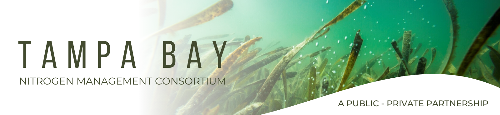

# Tampa Bay Nutrient Management Strategy {.unnumbered}

This book is the web companion to the **2027 Reasonable Assurance Plan (RA) Update** prepared by the Tampa
Bay Estuary Program (TBEP) and the Tampa Bay Nitrogen Management Consortium (NMC) for the Florida
Department of Environmental Protection (FDEP) and US Environmental Protection Agency (USEPA). It presents the narrative, figures, and tables of the
RA Update for the **2022–2026 reporting period**, with each figure and table linked back to the
analysis code that produces it in this repository,
[`tbep-tech/reasonable-assurance-analysis`](https://github.com/tbep-tech/reasonable-assurance-analysis).

::: {.callout-note}
## Reproducibility

Figures and tables are generated programmatically, not hand-edited. Run `R/dat_proc.R` (data
assembly) → `R/figs.R` (figures) and `R/docs.R` (tables). Loading inputs come from the companion
[`tbep-tech/load-estimates`](https://github.com/tbep-tech/load-estimates) pipeline; water-quality
thresholds and segment averaging use the [`tbeptools`](https://tbep-tech.github.io/tbeptools/) R
package. All historic and contemporary loading information is openly accessible at
<https://tbep.org/tampa-bay-nitrogen-loads>.
:::

Prior Reasonable Assurance Updates were submitted in 2002, 2007 (with a 2009 Addendum), 2012, 2017,
and 2022. As of the 2022 RA Update, FDEP concluded the document "satisfies the requirements for
continued approval of the RAP," and concurred that the proposed NMC corrective actions were
"reasonable and sufficient to address the issues in Old Tampa Bay," requesting periodic updates on
corrective-action implementation over the 2022–2026 period.

::: {.headline}
**Headline finding for 2022–2026:** FDEP-adopted chlorophyll-*a* thresholds were met in **all** major
bay segments over the 2022–2026 RA period (see *Overview*, Figure 2). This represents a marked
improvement in overall water quality, **particularly in Old Tampa Bay (OTB)**, which did not meet its
chlorophyll-*a* numeric nutrient criteria in four of the five years of the preceding (2017–2021)
period.
:::

Use the sidebar to navigate: the **Overview** chapter covers the waterbody, water-quality goals,
nitrogen loading, and seagrass habitat; the **Summary** chapter covers corrective actions, progress
since 2022, and the delivery-ratio table; and **Provenance** maps every deliverable to its source
code.
