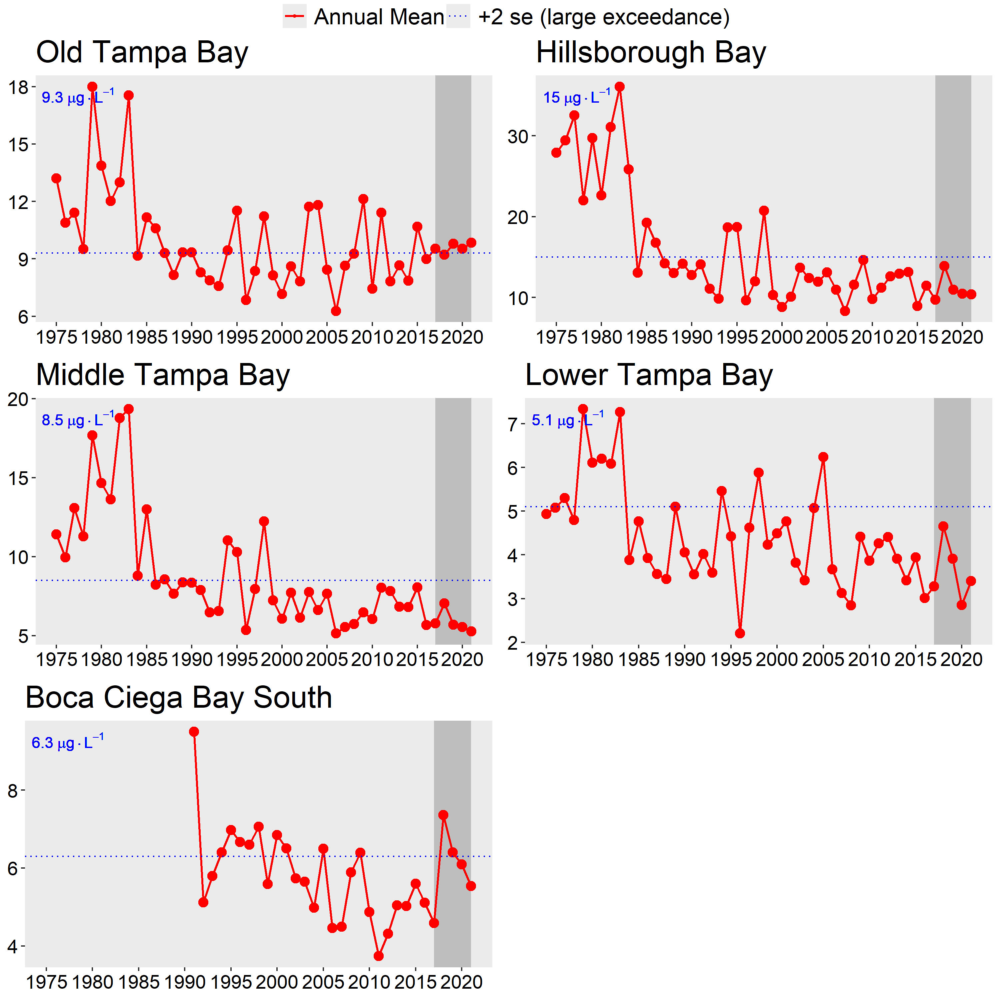

# 1. Description of the Waterbody

The Tampa Bay estuary is located on the eastern shore of the Gulf of Mexico in Florida (Figure 1).
At 882 km², it is Florida's largest open-water estuary. More than 3 million people live in the
5,870 km² watershed. Land use in the watershed is mixed — about 32% undeveloped, 17% agricultural,
42% urban and suburban residential, and the remaining 9% mining. Major habitats include mangroves,
salt marshes, salt barrens, and submerged aquatic vegetation.

Between 1950 and 1988, an estimated 42% of the seagrass acreage in Tampa Bay was lost, primarily
through excess nitrogen loading and related increases in phytoplankton concentrations that limited
light for seagrass survival and growth. In 1980, all municipal wastewater treatment plants were
required to provide 100% reuse or Advanced Wastewater Treatment (AWT) for discharges directly to the
bay and its tributaries; together with stormwater regulations enacted in the 1980s, these reduced
nitrogen loads to the bay. The 1976 TN loadings are more than three times greater than current
estimates (1976 = 9,904 tons TN/yr vs. a 2020s annual average of 3,321 tons TN/yr).

The Tampa Bay Nitrogen Management Consortium (NMC) was formed in 1996 and includes local governments
and agencies, phosphate companies, port industries, electric utilities, and agricultural interests
that work cooperatively in a voluntary framework to maintain nitrogen loads supporting seagrass
restoration. In 2020, the TBEP and partners updated the Habitat Master Plan, adopting a goal of
maintaining at least **40,000 acres** of seagrass baywide.

Between 2022 and 2026, seagrass coverage increased by **1,426 acres baywide**, while the Old Tampa Bay
segment continued to see losses. Baywide seagrass coverage was estimated at **31,563 acres in 2026**,
remaining below the 40,000-acre protection and recovery goal for a second consecutive RA assessment
period.

{fig-alt="Land use and land cover map of the Tampa Bay watershed"}

::: {.provenance}
**Figure 1 source:** [`R/figs.R`](https://github.com/tbep-tech/reasonable-assurance-analysis/blob/main/R/figs.R)
→ section *current land use figure* · **Data:** `data/lulc2023.RData`, `data/sgdat2024.RData`,
`data/fluccslkup.RData`, `data/tbep2225.RData`
:::

## 1.a. Name:

**2027 RA Update:** No change. This document addresses the four main bay segments of Tampa Bay: Old
Tampa Bay, Hillsborough Bay, Middle Tampa Bay and Lower Tampa Bay. As of the 2009 RA Addendum, an
additional segment was included: "Remainder of Lower Tampa Bay," which includes Terra Ceia Bay and
portions of the Manatee River and southern Boca Ciega Bay (Figure 5). The Old Tampa Bay,
Hillsborough Bay, Middle Tampa Bay and Lower Tampa Bay segments are identical to FDEP's established
estuary nutrient regions; the Remainder of Lower Tampa Bay RA Segment includes FDEP's Boca Ciega Bay
South, Terra Ceia Bay, and Manatee River Estuary nutrient regions (62-302.532(1), F.A.C.).

## 1.b. Location:

**2027 RA Update:** No change. Please refer to Figures 1 and 5.

## 1.c. Watershed/8-digit cataloging unit code:

**2027 RA Update:** No change. 03100206 Tampa Bay and coastal areas.

## 1.d. Type (lake, stream or estuary) of water:

**2027 RA Update:** No change. Estuary.

## 1.e. Water use classification:

**2027 RA Update:** Class II and III waters. See rule 62-302.400, F.A.C.

## 1.f. Designated use of waterbody:

**2027 RA Update:** No change. Per FDEP's 2026 303(d)/305(b) Integrated Water Quality Assessment and
the 2022–2024 Biennial Assessment, WBIDs in Tampa Bay proper are Category 2 (attaining some
designated uses) or 5 (standards not attained, TMDL required). The Category 5 WBIDs in the Old Tampa
Bay and Remainder of Lower Tampa Bay segments fall under the RA determination and are therefore
treated as Category 4b (a pollutant-control mechanism provides reasonable assurance of future
attainment) (Figure 6). This document does not address impairments related to Class II shellfish
harvesting areas in Tampa Bay.

{fig-alt="Map of FDEP water quality assessment categories for Tampa Bay WBIDs"}

::: {.provenance}
**Figure 6 source:** [`R/figs.R`](https://github.com/tbep-tech/reasonable-assurance-analysis/blob/main/R/figs.R)
→ section *wbid attainments* · **Data:** FDEP `Nutrients_305b` layer × RA segment watershed
:::

## 1.g. Area of the waterbody:

**2027 RA Update:** No change. The total surface area of the four major bay segments in Tampa Bay is
882 km² (approximately 341 square miles). When including the Remainder of Lower Tampa Bay, the total
surface area is 1,006 km² (approximately 389 square miles).

## 1.h. Pollutant(s) of concern:

**2027 RA Update:** No change. The pollutant of concern is Total Nitrogen (TN), the limiting nutrient
in Tampa Bay. Elevated nitrogen loading leads to excess algal growth (indicated by chlorophyll-*a*
concentrations), which reduces light penetration and causes loss of seagrass.

## 1.i. Suspected or documented sources of pollutant of concern:

**2027 RA Update:** The TBEP has developed loading reports for Tampa Bay since 1985; the most recent
estimates cover 2022–2026, openly accessible at <https://tbep.org/tampa-bay-nitrogen-loads>. Total
loadings are less variable than during the 1985–early-2000s period (Figure 7); 2024 loadings were
significantly influenced by rainfall from three tropical-storm systems. Per-capita TN loading has
decreased over time (Figure 8), as has the amount of TN delivered per unit water in each major bay
segment (Figure 9). Hydrologically-normalized total loads remain significantly below 1980s estimates
despite a growing metropolitan population (Figure 10).

**Table 1. Major TN loading sources by RA period.** Mean percentage contribution of major TN loading
sources for each 5-year Tampa Bay RA period; the final column is the current 2022–2026 period.

| Source | 2002 RA (1997–2001) | 2007 RA (2002–2006) | 2012 RA (2007–2011) | 2017 RA (2012–2016) | 2022 RA (2017–2021) | **2027 RA (2022–2026)** |
|---|---:|---:|---:|---:|---:|---:|
| NPS / Stormwater | 59.3 | 58.8 | 51.3 | 65.7 | 60.8 | **62.6** |
| Direct Atmospheric Deposition | 22.7 | 18.2 | 25.2 | 17.1 | 15.5 | **15.3** |
| Domestic Wastewater | 9.6 | 9.2 | 14.7 | 11.1 | 12.8 | **13.4** |
| Industrial Wastewater | 3.9 | 10.9 | 6.8 | 4.9 | 6.2 | **3.8** |
| Industrial Fertilizer Material Losses | 0.7 | 0.5 | 0.4 | 0.2 | 0.2 | **0.1** |
| Groundwater and Springs | 3.8 | 2.4 | 1.5 | 1.0 | 4.6 | **4.8** |

::: {.callout-note appearance="simple"}
Figure 7 (stacked-area TN load by major source category for each RA segment, 1985–2026, with TMDL
reference lines) and Figure 10 (hydrologically-normalized TN load vs. metropolitan population) are
generated in the [`tbep-tech/load-estimates`](https://github.com/tbep-tech/load-estimates) pipeline
and embedded directly in the RA Update document.
:::

{fig-alt="Bar chart of per-capita TN load by period"}

::: {.provenance}
**Figure 8 source:** [`R/figs.R`](https://github.com/tbep-tech/reasonable-assurance-analysis/blob/main/R/figs.R)
→ section *tn lbs per year per person* · **Data:** `totanndat` (load-estimates), `data/popdat.RData`
:::

{fig-alt="Small-multiple time series of TN and TP delivery ratios by bay segment"}

::: {.provenance}
**Figure 9 source:** [`R/figs.R`](https://github.com/tbep-tech/reasonable-assurance-analysis/blob/main/R/figs.R)
→ section *tn v hy all segs* · **Data:** `data/allsegdat8526.RData` →
[`data/loadratios1985-2025.csv`](https://github.com/tbep-tech/reasonable-assurance-analysis/blob/main/data/loadratios1985-2025.csv)
· The tabular form is **Appendix 6** in the *Summary* chapter.
:::

# 2. Description of Water Quality or Aquatic Ecological Goals

## 2.a. Water quality-based targets or aquatic ecological goals:

**2027 RA Update:** No change. The baywide seagrass restoration goal of 40,000 acres was adopted in
2020. Maintaining adequate water quality at adopted FDEP chlorophyll-*a* threshold levels in each
major bay segment on an annual-average basis is the primary metric for assessing progress toward the
seagrass restoration goal. A secondary goal — maintaining hydrologically-normalized total nitrogen
loads to each major bay segment — was adopted with the 2009 RA Addendum and later codified as the
numeric nutrient criteria for the Tampa Bay estuarine nutrient regions (62-302.532(1), F.A.C.). A
compliance assessment framework was established and has been used for all subsequent RA updates (2009
RA Addendum, Section VIII).

## 2.b. Averaging period:

**2027 RA Update:** No change. The TBEP uses annual-average bay-segment uncorrected chlorophyll-*a*
levels for tracking attainment, as approved by FDEP under the original 2002 RA submittal and adopted
in 2012 as NNC. Assessment methods are documented in the
[`tbeptools` introduction](https://tbep-tech.github.io/tbeptools/articles/intro.html); source code is
at [`tbep-tech/wq-dash`](https://github.com/tbep-tech/wq-dash).

{fig-alt="Small-multiple time series of chlorophyll-a by bay segment"}

::: {.provenance}
**Figure 2 source:** [`R/figs.R`](https://github.com/tbep-tech/reasonable-assurance-analysis/blob/main/R/figs.R)
→ section *annual chl means all segments* · **Functions:** `show_rathrplot()`, `raanlz_avedat()` in
[`R/funcs.R`](https://github.com/tbep-tech/reasonable-assurance-analysis/blob/main/R/funcs.R) ·
**Data:** `data/chldat.RData`
:::

## 2.c. How will goals result in restoration of impaired designated uses:

**2027 RA Update:** No change. Maintaining chlorophyll-*a* concentrations at target levels is expected
to maintain water clarity adequate to support seagrass at or above 40,000 acres throughout Tampa Bay,
ensuring that external nutrient loads do not result in an imbalance in the flora or fauna of Tampa
Bay.

## 2.d. Determining whether additional corrective actions are needed:

**2027 RA Update:** No changes to the TBEP's annual management Decision Matrix process, the Tampa Bay
NMC nutrient management strategy, or the allocation compliance assessment framework. Results of the
bay-segment-specific compliance assessment over the 2022–2026 RA period are described in Figure 11 and
Tables 2–6. **For the 2022–2026 RA period, no annual exceedances** of the chlorophyll-*a* thresholds
nor of hydrologically-normalized total nitrogen loads were observed, and the TN and TP numeric
nutrient criteria (Figure 9) were not exceeded.

{fig-alt="Small-multiple bar charts of seagrass coverage by bay segment"}

::: {.provenance}
**Figures 3 & 4 source:** [`R/figs.R`](https://github.com/tbep-tech/reasonable-assurance-analysis/blob/main/R/figs.R)
→ section *seagrass coverage by bay segment* · **Data:** SWFWMD Suncoast seagrass series × seagrass segments
:::

# 3. Description of Proposed Management Actions to be Undertaken

## 3.a. Participating Entities:

**2027 RA Update:** The Tampa Bay Estuary Program Policy Board includes the City of Tampa, City of
Clearwater, City of St. Petersburg, City of Largo, Manatee County, Hillsborough County, Pinellas
County, Pasco County, FDEP, the Southwest Florida Water Management District, and the U.S.
Environmental Protection Agency (Ex-officio). The Tampa Bay Nitrogen Management Consortium includes
over 45 participating public and private partners — spanning counties and municipalities, state and
federal agencies, port and utility interests, and phosphate, agricultural, and industrial partners.

## 3.b. Existing and proposed management activities:

**2027 RA Update:** Consortium participants document completed and planned TN load-reduction projects
in the online Tampa Bay Action Plan Database (<https://apdb.tbep.org>). Corrective-action and
restoration projects implemented over 2022–2026 are summarized in the *Summary* chapter (Section 5).

## 3.c. Geographic scope of any proposed management activity:

**2027 RA Update:** No change. The NMC Action Plan projects are located throughout the Tampa Bay
watershed.

## 3.d. Estimated Pollutant Load Reduction Anticipated from each activity:

**2027 RA Update:** Based on projects implemented over 2022–2026, cumulatively an additional
**33.1 tons/yr** of TN has been precluded from entering Tampa Bay (Table 7). Approximately
**106.8 tons/yr** of TN is estimated to be precluded after 2026 (Tables 8 & 9).

## 3.e. Written agreements committing partners to actions:

**2027 RA Update:** The Tampa Bay Nitrogen Management Consortium gave consensus approval (with no
objections) at their 2027 meeting to submit this document to FDEP as the 2027 RA Update for Tampa
Bay. Participation status, meeting notes, presentations, and decision memos are at
<https://tbep.org/our-work/boards-committees/nitrogen-management-consortium/>.

## 3.f. How will future growth and new sources be addressed:

**2027 RA Update:** Consistent with prior RA approvals and the 2009 RA Addendum, allocations to all TN
loading sources are formalized and cumulatively capped at the federally-recognized TMDL for each bay
segment. Reviews of interim, new, and transferred sources led to formal NMC concurrence of allocations
assigned to each entity for the 2027–2031 RA implementation period (Tables 10–14), remaining within
the TMDL limits.

## 3.g. Confirmed sources of funding:

**2027 RA Update:** No change. Consortium participants abide by recommended funding levels for the
NMC's process to deliver 5-year RA updates. Participants have planned investments of **$137,428,003**
to continue and implement projects listed in Tables 8 and 9.

## 3.h. Implementation schedule:

**2027 RA Update:** No change. Consortium participants continue to develop future load-reduction
projects and document them in the online Tampa Bay Action Plan Database (<https://apdb.tbep.org>).
Table 8 lists ongoing projects; Table 9 lists projects planned to be initiated/completed after 2026.

## 3.i. Enforcement programs, if the management strategy is not voluntary:

**2027 RA Update:** No change. Participation in the Consortium remains voluntary, and NMC partners
continue to encourage non-participating point and nonpoint sources to join. The allocation compliance
assessment process (Section 2.a) continues during the 2027–2031 RA implementation period; an
assessment of the 2022–2026 period is in Appendices 1–5. FDEP and other regulatory agencies continue
to ensure permitted facilities meet all permit requirements through existing regulatory and
enforcement programs.
