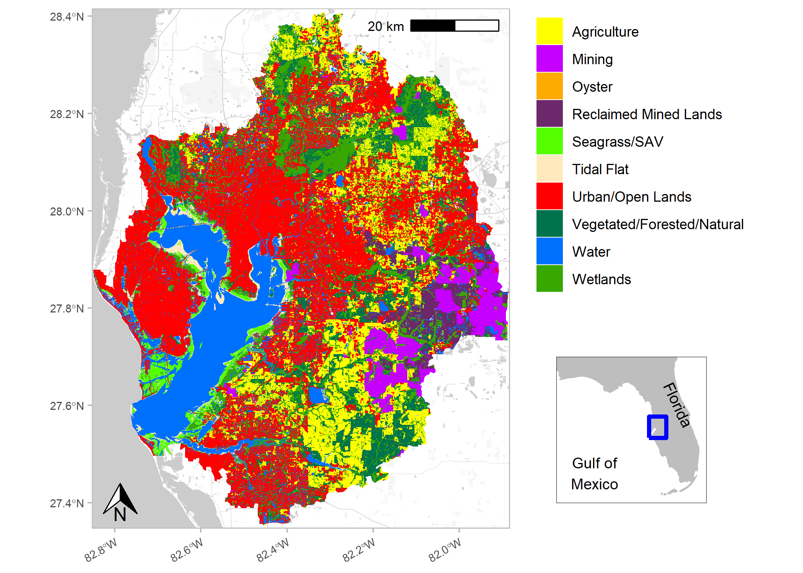
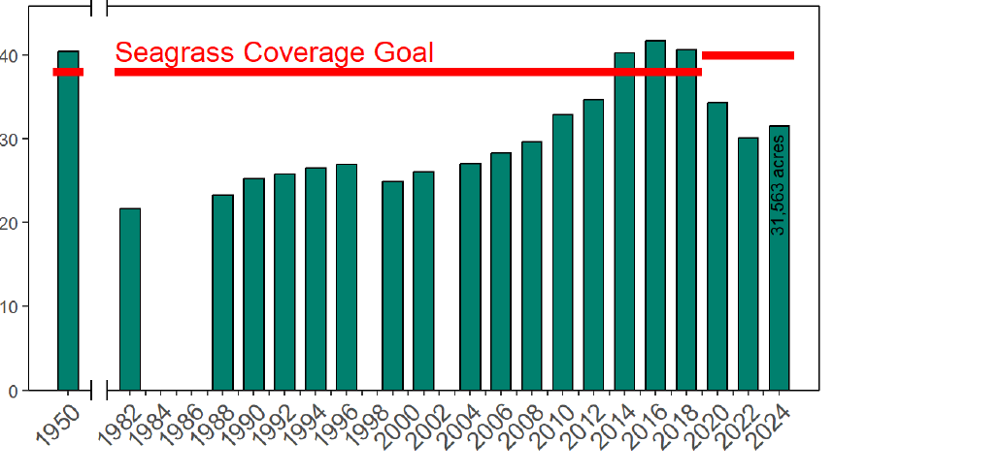
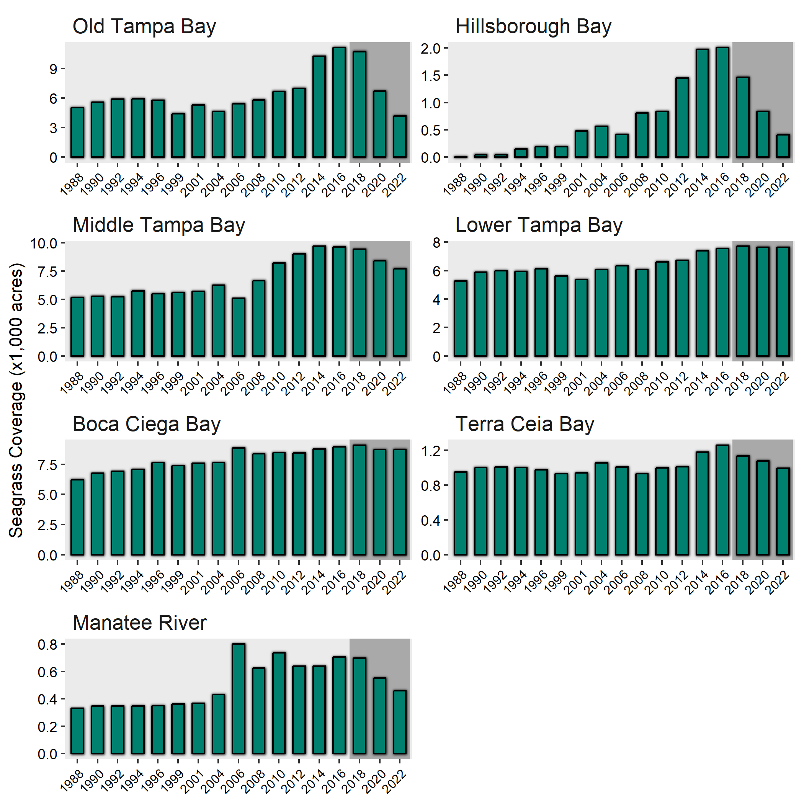
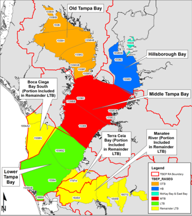
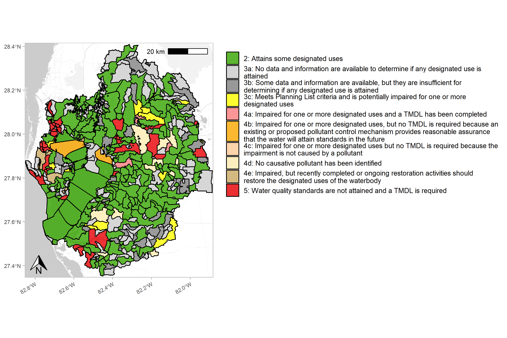
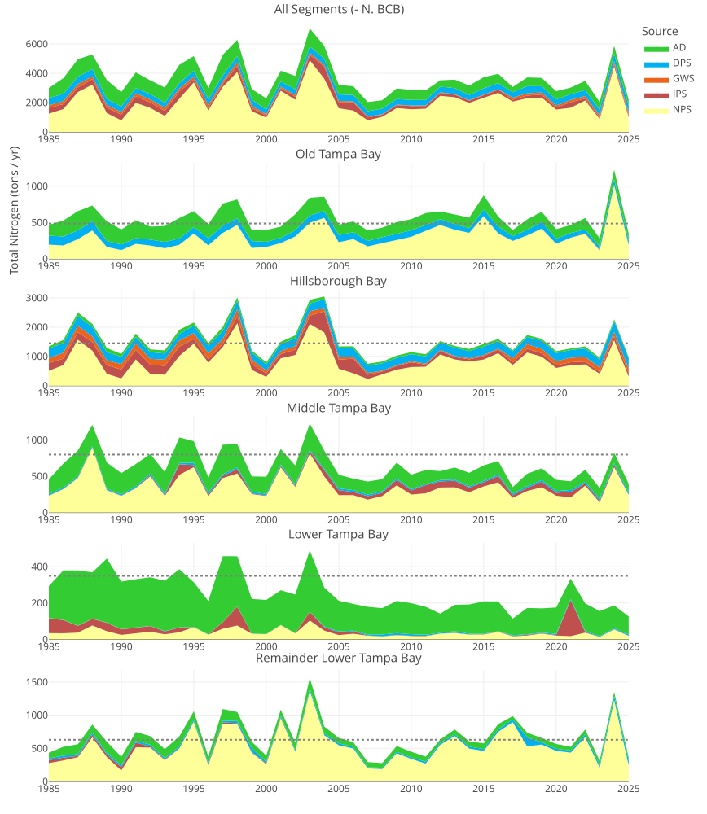
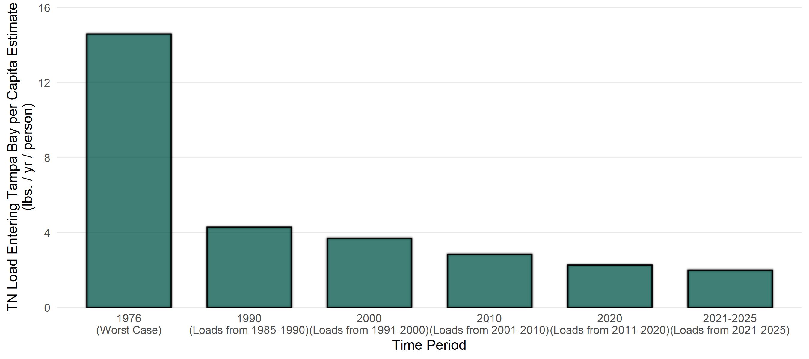
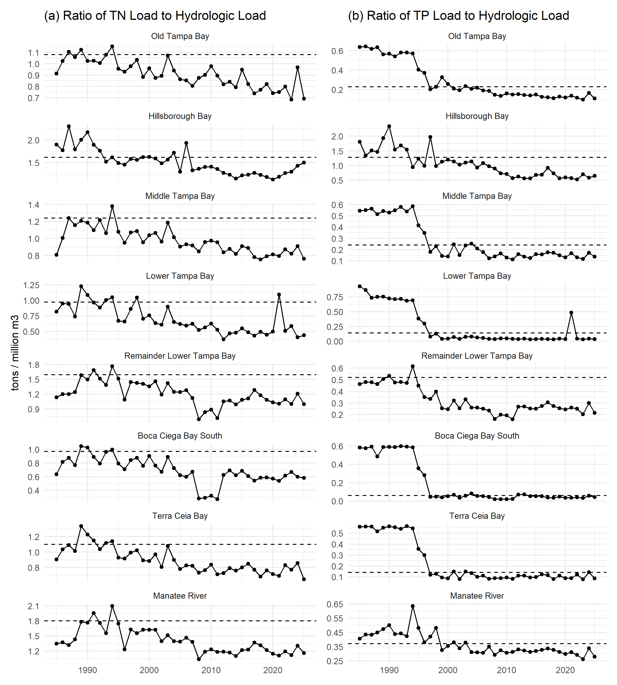
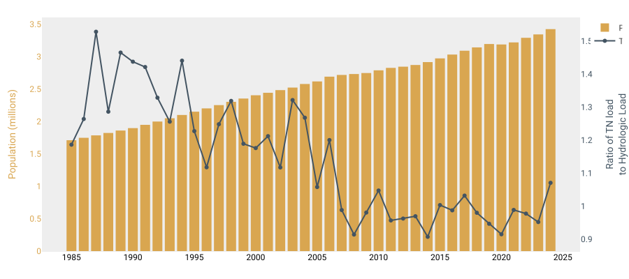
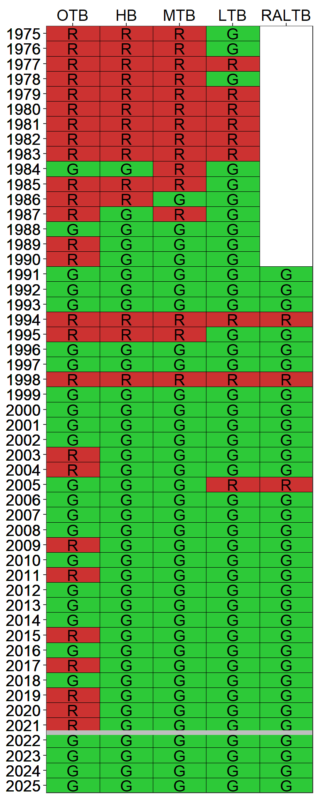

# 1. Description of the Waterbody

The Tampa Bay estuary is located on the eastern shore of the Gulf of Mexico in Florida (Figure 1).
At 882 km², it is Florida's largest open-water estuary. More than 3 million people live in the
5,870 km² watershed. Land use in the watershed is mixed — about 32% undeveloped, 17% agricultural,
42% urban and suburban residential, and the remaining 9% mining. Major habitats include mangroves,
salt marshes, salt barrens, and submerged aquatic vegetation.

Between 1950 and 1988, an estimated 42% of the seagrass acreage in Tampa Bay was lost, primarily
through excess nitrogen loading and related increases in phytoplankton concentrations that limited
light for seagrass survival and growth. In 1980, all municipal wastewater treatment plants were
required to provide 100% reuse or Advanced Wastewater Treatment (AWT) for discharges directly to the
bay and its tributaries. Together with stormwater regulations enacted in the 1980s, significant
nitrogen loads reductions to the bay occurred. In hindsight, 1976 TN loadings were more than three times 
greater than current estimates (1976 = 9,904 tons TN/yr vs. a 2020s annual average of 3,321 tons TN/yr; 
see: [https://tbep.org/tampa-bay-nitrogen-loads/](https://tbep.org/tampa-bay-nitrogen-loads/)).

The Tampa Bay Nitrogen Management Consortium (NMC) was formed in 1996 and includes local governments
and agencies, phosphate companies, port industries, electric utilities, and agricultural interests
that work cooperatively in a voluntary framework to maintain nitrogen loads supporting seagrass
restoration. In 2020, the TBEP and partners updated the [Tampa Bay Habitat Master Plan](https://tbep.org/habitat-master-plan-update/) and adopted the goal of
maintaining at least **40,000 acres** of seagrass baywide.

{fig-alt="Land use and land cover map of the Tampa Bay watershed"}

::: {.provenance}
**Figure 1:** [`R/figs.R`](https://github.com/tbep-tech/reasonable-assurance-analysis/blob/main/R/figs.R)
→ *current land use figure* · generated from repository code.
:::

Recent data and observations from Tampa Bay indicate that continuing efforts to reduce nitrogen loading by the NMC partners are resulting in water quality sufficient to maintain stable seagrasses in most bay segments. Time series plots show that FDEP-adopted chlorophyll-a thresholds have been met in all major bay segments over the 2022-2026 RA period (Figure 2). These results represent improvement in overall water quality conditions in Tampa Bay, particularly in the Old Tampa Bay (OTB) segment which did not meet chlorophyll-a numeric nutrient criteria in four of the five years represented in the 2022 RA Update period (2017 - 2021).

{fig-alt="Small-multiple time series of chlorophyll-a by bay segment through 2025"}

::: {.provenance}
**Figure 2:** reproduced from the 2027 RA Update; equivalently generated by
[`R/figs.R`](https://github.com/tbep-tech/reasonable-assurance-analysis/blob/main/R/figs.R)
→ *annual chl means all segments* (`show_rathrplot()`, `raanlz_avedat()`), from `data/chldat.RData`.
:::

Consequently between 2022 and 2026, seagrass coverage increased by **1,426 acres baywide**. However, the Old Tampa Bay
segment continued to see losses. Baywide seagrass coverage was estimated at **31,563 acres in 2024**
(Figure 3), remaining below the 40,000-acre protection and recovery goal for a second consecutive RA
assessment period. Historic changes by segment (Figure 4) show the long-term increase to the 2016
baywide maximum; coverage increased in all segments during 2022–2026 except Old Tampa Bay.

{fig-alt="Bar chart of baywide seagrass acreage 1950-2024 with coverage goal line"}

{fig-alt="Small-multiple bar charts of seagrass coverage by bay segment"}

::: {.provenance}
**Figure 3:** reproduced from the 2027 RA Update (TBEP & SWFWMD). · **Figure 4:**
[`R/figs.R`](https://github.com/tbep-tech/reasonable-assurance-analysis/blob/main/R/figs.R)
→ *seagrass coverage by bay segment* · generated from repository code.
:::

## 1.a. Name:

**2027 RA Update:** No change. This document addresses the four main bay segments of Tampa Bay: Old
Tampa Bay, Hillsborough Bay, Middle Tampa Bay and Lower Tampa Bay. As of the 2009 RA Addendum, an
additional segment was included: "Remainder of Lower Tampa Bay," which includes Terra Ceia Bay and
portions of the Manatee River and southern Boca Ciega Bay (Figure 5). The Old Tampa Bay,
Hillsborough Bay, Middle Tampa Bay and Lower Tampa Bay segments are identical to FDEP's established
estuary nutrient regions; the Remainder of Lower Tampa Bay RA Segment includes FDEP's Boca Ciega Bay
South, Terra Ceia Bay, and Manatee River Estuary nutrient regions ([62-302.532(1), F.A.C.](https://www.flrules.org/gateway/RuleNo.asp?ID=62-302.532)).

{fig-alt="Map of TBEP RA bay segment boundaries overlaid with FDEP WBIDs"}

::: {.provenance}
**Figure 5:** reproduced from the 2027 RA Update (boundary map, 2009 RA Addendum basis).
:::

## 1.b. Location:

**2027 RA Update:** No change. Please refer to Figures 1 and 5.

## 1.c. Watershed/8-digit cataloging unit code:

**2027 RA Update:** No change. 03100206 Tampa Bay and coastal areas.

## 1.d. Type (lake, stream or estuary) of water:

**2027 RA Update:** No change. Estuary.

## 1.e. Water use classification:

**2027 RA Update:** Class II and III waters. See rule [62-302.400, F.A.C.](https://www.flrules.org/gateway/RuleNo.asp?ID=62-302.400)

## 1.f. Designated use of waterbody:

**2027 RA Update:** No change. Per FDEP's 2026 303(d)/305(b) Integrated Water Quality Assessment and
the 2022–2024 Biennial Assessment, WBIDs in Tampa Bay proper are Category 2 (attaining some
designated uses) or 5 (standards not attained, TMDL required). The Category 5 WBIDs in the Old Tampa
Bay and Remainder of Lower Tampa Bay segments fall under the RA determination and are therefore
treated as Category 4b (a pollutant-control mechanism provides reasonable assurance of future
attainment) (Figure 6). This document does not address impairments related to Class II shellfish
harvesting areas in Tampa Bay.

{fig-alt="Map of FDEP water quality assessment categories for Tampa Bay WBIDs"}

::: {.provenance}
**Figure 6:** [`R/figs.R`](https://github.com/tbep-tech/reasonable-assurance-analysis/blob/main/R/figs.R)
→ *wbid attainments* · generated from repository code.
:::

## 1.g. Area of the waterbody:

**2027 RA Update:** No change. The total surface area of the four major bay segments in Tampa Bay is
882 km² (approximately 341 square miles). When including the Remainder of Lower Tampa Bay, the total
surface area is 1,006 km² (approximately 389 square miles).

## 1.h. Pollutant(s) of concern:

**2027 RA Update:** No change. The pollutant of concern is Total Nitrogen (TN), the limiting nutrient
in Tampa Bay. Elevated nitrogen loading leads to excess algal growth (indicated by chlorophyll-*a*
concentrations), which reduces light penetration and causes seagrass coverage loss.

## 1.i. Suspected or documented sources of pollutant of concern:

**2027 RA Update:** The TBEP has developed loading reports for Tampa Bay since 1985. The most recent
estimates cover the 2022–2026 period and are openly accessible at <https://tbep.org/tampa-bay-nitrogen-loads>. Table 1 shows the proportion of major contributing sources of TN load to Tampa Bay over the current and prior, 5-year RA assessment periods. Total nitrogen loadings are less variable than during the 1985 to early-2000s period (Figure 7). In 2024, loadings were
significantly influenced by excessive rainfall stemming from three tropical-storm systems. Despite these events, per-capita TN loading continues to decrease over time (Figure 8), as has the amount of TN delivered per unit water in each major bay
segment (Figure 9). Hydrologically-normalized total loads remain significantly below 1980s estimates
despite a growing metropolitan population (Figure 10).

**Table 1. Major TN loading sources by RA period.** Mean percentage contribution of major TN loading
sources for each 5-year Tampa Bay RA period; the final column is the current 2022–2026 period.

| Source | 2002 RA<br>(1997–2001) | 2007 RA<br>(2002–2006) | 2012 RA<br>(2007–2011) | 2017 RA<br>(2012–2016) | 2022 RA<br>(2017–2021) | **2027 RA<br>(2022–2026)** |
|---|---:|---:|---:|---:|---:|---:|
| NPS / Stormwater | 59.3 | 58.8 | 51.3 | 65.7 | 60.8 | **62.6** |
| Direct Atmospheric Deposition | 22.7 | 18.2 | 25.2 | 17.1 | 15.5 | **15.3** |
| Domestic Wastewater | 9.6 | 9.2 | 14.7 | 11.1 | 12.8 | **13.4** |
| Industrial Wastewater | 3.9 | 10.9 | 6.8 | 4.9 | 6.2 | **3.8** |
| Industrial Fertilizer Material Losses | 0.7 | 0.5 | 0.4 | 0.2 | 0.2 | **0.1** |
| Groundwater and Springs | 3.8 | 2.4 | 1.5 | 1.0 | 4.6 | **4.8** |

{fig-alt="Stacked-area charts of TN load by source category for each bay segment"}

{fig-alt="Bar chart of per-capita TN load by period"}

{fig-alt="Small-multiple time series of TN and TP delivery ratios by bay segment"}

{fig-alt="Population bars with TN-to-hydrology ratio line, 1985-2025"}

::: {.provenance}
**Table 1, Figures 7 & 10:** TN loading estimates from
[`tbep-tech/load-estimates`](https://github.com/tbep-tech/load-estimates); Figures 7 & 10 reproduced
from the 2027 RA Update. · **Figure 8:** [`R/figs.R`](https://github.com/tbep-tech/reasonable-assurance-analysis/blob/main/R/figs.R)
→ *tn lbs per year per person*. · **Figure 9:** `R/figs.R` → *tn v hy all segs*
(→ [`data/loadratios1985-2025.csv`](https://github.com/tbep-tech/reasonable-assurance-analysis/blob/main/data/loadratios1985-2025.csv); tabular form in *Summary*, Appendix 6).
:::

# 2. Description of Water Quality or Aquatic Ecological Goals

## 2.a. Water quality-based targets or aquatic ecological goals:{#2a}

**2027 RA Update:** No change. The baywide seagrass restoration goal of 40,000 acres was adopted in
2020. Maintaining adequate water quality at adopted FDEP chlorophyll-*a* threshold levels in each
major bay segment on an annual-average basis is the primary metric for assessing progress toward the
seagrass restoration goal (see Figure 2). A secondary goal — maintaining hydrologically-normalized total nitrogen
loads to each major bay segment — was adopted with the 2009 RA Addendum and later codified as the
numeric nutrient criteria for the Tampa Bay estuarine nutrient regions ([62-302.532(1), F.A.C.](https://www.flrules.org/gateway/RuleNo.asp?ID=62-302.532)). A compliance assessment framework was established and has been utilized for all subsequent reasonable assurance updates (see [2009 RA Addendum, Section VIII](https://drive.google.com/drive/folders/1YMxNMXVOpStaJolzIgjW6-0CQZbPWQqw)). 

## 2.b. Averaging period:

**2027 RA Update:** No change. The TBEP uses annual-average bay-segment uncorrected chlorophyll-*a*
levels for tracking attainment, as [approved by FDEP under the original 2002 RA submittal](https://drive.google.com/file/d/1XDq7MFKaiMRtZgdcq5j8PVHXYPTRaSfj/view?usp=sharing) and adopted
in 2012 as NNC under subsection 62-302.532(1), F.A.C. for Old Tampa Bay, Hillsborough Bay, Middle Tampa Bay and Lower Tampa Bay (the same value is used for assessing the Remainder of LTB). An annual evaluation of TN load attainment is predicated on the water quality assessment as outlined in the compliance assessment framework identified above. Annual bay segment assessment methods are documented in the [`tbeptools` introduction](https://tbep-tech.github.io/tbeptools/articles/intro.html); source code is at [`tbep-tech/wq-dash`](https://github.com/tbep-tech/wq-dash).

## 2.c. How will goals result in restoration of impaired designated uses:

**2027 RA Update:** No change. Maintaining chlorophyll-*a* concentrations at target levels is expected
to maintain water clarity adequate to support seagrass at or above 40,000 acres throughout Tampa Bay,
ensuring that external nutrient loads do not result in an imbalance in the flora or fauna of Tampa
Bay.

## 2.d. Determining whether additional corrective actions are needed:

**2027 RA Update:** No changes to the TBEP's [annual management Decision Matrix process](https://tbep.org/water-quality-report-card/), the Tampa Bay
NMC nutrient management strategy, or the allocation compliance assessment framework. Results of the
bay-segment-specific compliance assessment over the 2022–2026 RA period are shown in Figure 11 and described in Tables 2–6.
**For the 2022–2026 RA period, no annual exceedances** of the chlorophyll-*a* thresholds nor of
hydrologically-normalized total nitrogen loads were observed. Likewise, TN and TP numeric nutrient
criteria (Figure 9) were not exceeded. (2026 outcomes are shown as *pending* until the period closes.)

{fig-alt="Grid of annual chlorophyll-a threshold attainment by bay segment through 2025"}

::: {.provenance}
**Figure 11:** chlorophyll-*a* attainment grid, TBEP (through 2025).
:::

Green shaded cells in Tables 2-6 indicate a decision-point outcome consistent with a reasonable assurance determination (NNC threshold met / normalized load below the TMDL). All 2026 values are shown as *pending* until the RA period closes.

```{r}
#| label: ra-assessment-tables
#| results: asis
library(flextable)

ra_steps <- function(tbl_no, seg, threshold, tmdl, a1, a3) {
  df <- data.frame(
    step = c(
      paste0("NMC Action 1: Determine if observed chlorophyll-a exceeds FDEP threshold of ",
             threshold, " ug/L"),
      "NMC Action 2: Determine if any observed chlorophyll-a exceedances occurred for 2 consecutive years",
      paste0("NMC Action 3: Determine if observed hydrologically-normalized total load exceeds ",
             "federally-recognized TMDL of ", tmdl, " tons/year"),
      paste0("NMC Actions 4-5: Determine if any entity/source/facility specific exceedances of ",
             "5-yr average allocation occurred during implementation period")),
    y1 = c(a1[1], "No", a3[1], ""), y2 = c(a1[2], "No", a3[2], ""),
    y3 = c(a1[3], "No", a3[3], ""), y4 = c(a1[4], "No", a3[4], ""),
    y5 = c(a1[5], "No", a3[5], ""),
    outcome = c("All years below threshold so far, not necessary for NMC Actions 2-5",
                "All years met threshold, not necessary for NMC Actions 3-5",
                "Not necessary due to observed water quality and seagrass conditions in the bay segment",
                "Not necessary when chlorophyll-a threshold met"),
    check.names = FALSE, stringsAsFactors = FALSE)

  ft <- flextable(df)
  ft <- set_header_labels(ft, step = "Bay Segment Reasonable Assurance Assessment Steps",
                          y1 = "Year 1 (2022)", y2 = "Year 2 (2023)", y3 = "Year 3 (2024)",
                          y4 = "Year 4 (2025)", y5 = "Year 5 (2026)", outcome = "OUTCOME")
  ft <- add_header_row(ft, values = c("", "DATA USED TO ASSESS ANNUAL REASONABLE ASSURANCE", ""),
                       colwidths = c(1, 5, 1))
  # bay-segment name as a top header row spanning all columns
  ft <- add_header_row(ft, values = sub("^the ", "", seg), colwidths = ncol(df), top = TRUE)
  ft <- merge_at(ft, i = 2:3, j = 1, part = "header")
  ft <- merge_at(ft, i = 2:3, j = 7, part = "header")
  ft <- merge_at(ft, i = 4, j = 2:6, part = "body")
  ft <- bg(ft, bg = "#BDD7EE", part = "header")
  ft <- bold(ft, i = 1, part = "header")
  ft <- align(ft, i = 1, align = "center", part = "header")
  for (r in 1:3) for (cc in 2:6) {
    val <- df[r, cc]
    ft <- bg(ft, i = r, j = cc,
             bg = if (grepl("Pending", val)) "#E2EFDA" else "#A9D08E", part = "body")
  }
  ft <- align(ft, j = 2:6, align = "center", part = "all")
  ft <- valign(ft, valign = "top", part = "body")
  ft <- border_outer(ft); ft <- border_inner(ft)
  ft <- fontsize(ft, size = 9, part = "all")
  ft <- set_caption(ft, paste0("Table ", tbl_no,
        ". Demonstration of reasonable assurance assessment steps for ", seg, "."))
  ft <- set_table_properties(ft, layout = "autofit", width = 1)
  ft
}

segs <- list(
  list(2, "Table 2: Old Tampa Bay", "9.3", "486",
       c("No (7.1)","No (6.2)","No (8.8)","No (6.6)","Pending (7.5)"),
       c("No (359)","No (308)","No (435)","No (311)","No (Pending)")),
  list(3, "Table 3: Hillsborough Bay", "15", "1451",
       c("No (8.9)","No (6.9)","No (10.7)","No (10)","Pending (8.2)"),
       c("No (1,138)","No (1,163)","No (1,281)","No (1,344)","No (Pending)")),
  list(4, "Table 4: Middle Tampa Bay", "8.5", "799",
       c("No (5)","No (3.7)","No (7.8)","No (5.5)","Pending (4.9)"),
       c("No (564)","No (531)","No (587)","No (492)","No (Pending)")),
  list(5, "Table 5: Lower Tampa Bay", "5.1", "349",
       c("No (3.6)","No (2.6)","No (4.6)","No (3)","Pending (3.3)"),
       c("No (186)","No (215)","No (148)","No (161)","No (Pending)")),
  list(6, "Table 6: Remainder of Lower Tampa Bay", "5.1", "629",
       c("No (3.6)","No (2.6)","No (4.6)","No (3)","Pending (3.3)"),
       c("No (463)","No (424)","No (511)","No (421)","No (Pending)")))

for (s in segs) {
  ft <- ra_steps(s[[1]], s[[2]], s[[3]], s[[4]], s[[5]], s[[6]])
  cat("\n\n")
  flextable_to_rmd(ft)
  cat("\n\n")
}
```

# 3. Description of Proposed Management Actions to be Undertaken

## 3.a. Participating Entities:

**2027 RA Update:** The Tampa Bay Estuary Program Policy Board includes: 

:::: {.columns}

::: {.column width="45%"}
* City of Tampa
* City of Clearwater
* City of St. Petersburg
* City of Largo
* Manatee County
* Hillsborough County
* Pinellas County

:::

::: {.column width="10%"}
<!-- empty column to create gap -->
:::

::: {.column width="45%"}
* Pasco County
* FL Department of Environmental Protection
* Southwest FL Water Management District
* U.S. Environmental Protection Agency (Ex-officio)

:::

::::

The Tampa Bay Nitrogen Management Consortium includes over 45 participating public and private partners — spanning additional counties and municipalities, state and federal agencies, port and utility interests, and phosphate, agricultural, and industrial partners.

[2027 TBNMC Public Partners]{.underline}

:::: {.columns}

::: {.column width="45%"}
* Tampa Bay Estuary Program
* U.S. Environmental Protection Agency
* FL Department of Environmental Protection
* FL Department of Agriculture & Consumer Services
* FL Department of Transportation
* Southwest FL Water Management District
* MacDill Air Force Base
* Tampa Bay Regional Planning Council
* Tampa Bay Water
* Tampa Port Authority
* Environmental Protection Commission of Hillsborough County
* Hillsborough County
* Manatee County
* Pasco County

:::

::: {.column width="10%"}
<!-- empty column to create gap -->
:::

::: {.column width="45%"}
* Pinellas County
* Polk County
* Sarasota County
* City of Bradenton
* City of Clearwater
* City of Gulfport
* City of Lakeland
* City of Largo
* City of Mulberry
* City of Oldsmar
* City of Palmetto
* City of Pinellas Park
* City of Plant City
* City of Safety Harbor
* City of St. Petersburg
* City of Tampa

:::

::::

[2027 TBNMC Private Partners]{.underline}

:::: {.columns}

::: {.column width="45%"}
* Busch Entertainment
* ZooTampa
* Mosaic Company
* Tampa Port Services, LLC
* Kinder Morgan Bulk Terminals, Inc.
* Piney Point Receivership
* Tampa Electric Company
* Duke Energy Florida, LLC

:::

::: {.column width="10%"}
<!-- empty column to create gap -->
:::

::: {.column width="45%"}
* CSX Transportation
* Tropicana Products, Inc.
* Kerry I&F Contracting
* Trademark Nitrogen
* Yara North America
* Alafia Preserve, LLC
* Eagle Ridge, LLC
* LDC Donaldson Knoll Investments, LLC

:::

::::

## 3.b. Existing and proposed management activities:

**2027 RA Update:** Consortium participants have documented completed and planned TN load-reduction projects
in the online Tampa Bay Action Plan Database (<https://apdb.tbep.org>). Completed, ongoing, and future
projects for the period are listed in **Tables 7–9** (see the *Action Plan & Allocation Tables*
chapter). Corrective-action and restoration projects are summarized in the *Summary* chapter
(Section 5).

Over the 2022-2026 RA implementation period, **29 projects** were implemented in the Tampa Bay watershed by Consortium participants. Cumulatively, for those projects that have load reduction estimates associated with them, a TN load reduction of **33.1 tons/year** was estimated over the 2022-2026 period (Table 7). This amount would likely be larger if estimates were developed for all projects. 

In addition, Consortium participants continue to look towards the future and have plans to implement or continue to implement a number of projects post-2026. Table 8 lists projects that are being continued by Consortium participants and include education components. Table 9 lists projects that are planned to be initiated/completed in specific years or are in progress of being completed during the 2027-2031 RA Implementation period. Combining information from both tables’ projects where load reductions can be estimated, approximately **106.8 tons/year** of TN is estimated to be precluded from entering the bay in the future.

## 3.c. Geographic scope of any proposed management activity:

**2027 RA Update:** No change. The NMC Action Plan projects are located throughout the Tampa Bay
watershed.

## 3.d. Estimated Pollutant Load Reduction Anticipated from each activity:

**2027 RA Update:** Based on projects implemented over 2022–2026, cumulatively an additional
**33.1 tons/yr** of TN has been precluded from entering Tampa Bay (Table 7). Approximately
**106.8 tons/yr** of TN is estimated to be precluded after 2026 (Tables 8 & 9).

## 3.e. Written agreements committing partners to actions:

**2027 RA Update:** The Tampa Bay Nitrogen Management Consortium gave consensus approval (with no
objections) at their **XXXXXX 2027** meeting to submit this document to FDEP as the 2027 RA Update for Tampa
Bay. Participation status, meeting notes, presentations, and decision memos are at
<https://tbep.org/our-work/boards-committees/nitrogen-management-consortium/>.

## 3.f. How will future growth and new sources be addressed:

**2027 RA Update:** Consistent with prior RA approvals and the 2009 RA Addendum, allocations to all TN
loading sources are formalized and cumulatively capped at the federally-recognized TMDL for each bay
segment. Reviews of interim, new, and transferred sources led to formal NMC concurrence of allocations
assigned to each entity for the 2027–2031 RA implementation period (**Tables 10–14**, in the *Action
Plan & Allocation Tables* chapter), remaining within the TMDL limits.

Lastly, the Tampa Bay NMC has developed recommended protocols to address any unforeseen need for a TN load allocation. Consortium participants have previously formalized a process to address [new, missed or expanded TN sources](https://drive.google.com/file/d/1q7vq4I3AysJM68XBjnpylUPwh7KLD--N/view?usp=sharing) in future RA updates, and FDEP has concurred with those recommendations. Lastly, during the development of the 2017 RA Update, Consortium participants developed recommendations for assignment of any unassigned reservation allocation that may occur in the future (see [Appendix 2 of the 2017 RA Update](https://drive.google.com/file/d/1VdYE67_aZAhFq6JYQSKxx2WY2O5KwyUI/view?usp=sharing)). 

## 3.g. Confirmed sources of funding:

**2027 RA Update:** No change. Consortium participants abide by recommended funding levels for the
NMC's process to deliver 5-year RA updates to the FDEP. For each 5-year RA period, all participating NMC entities with a 5-year annual average allocation less than one ton TN per year are requested to contribute a recommended nominal amount of **$750**, and all other sources are requested to contribute a one-time recommended amount of **$7,500**. Consortium contributions are due generally in Years 1-2 of each RA cycle, to allow time for development of the technical basis required for an update. All entities with allocations or providing regulatory oversight/input to the RA Update process (in-kind support) are invited to attend and encouraged to participate in all Consortium meetings and deliberations in the future. A chronology of NMC activities and meetings can be found at https://tbep.org/our-work/boards-committees/nitrogen-management-consortium/.

In addition, Consortium participants have planned investments of **$137,428,003** to continue projects listed in Table 8 and implement new projects listed in Table 9.

## 3.h. Implementation schedule:

**2027 RA Update:** No change. Consortium participants continue to develop future load reduction
projects and document them in the online Tampa Bay Action Plan Database (<https://apdb.tbep.org>).
Table 8 lists ongoing projects. Table 9 lists projects planned to be initiated/completed after 2026.

## 3.i. Enforcement programs, if the management strategy is not voluntary:

**2027 RA Update:** No change. Participation in the Consortium remains voluntary, and NMC partners
continue to encourage non-participating point and nonpoint sources to join. The allocation compliance
assessment process ([Section 2.a](#2a)) continues during the 2027–2031 RA implementation period; an
assessment of the 2022–2026 period is in [Appendices 1](@sec-app1)–[5](@sec-app5). FDEP and other regulatory agencies continue
to ensure permitted facilities meet all permit requirements through existing regulatory and
enforcement programs.
