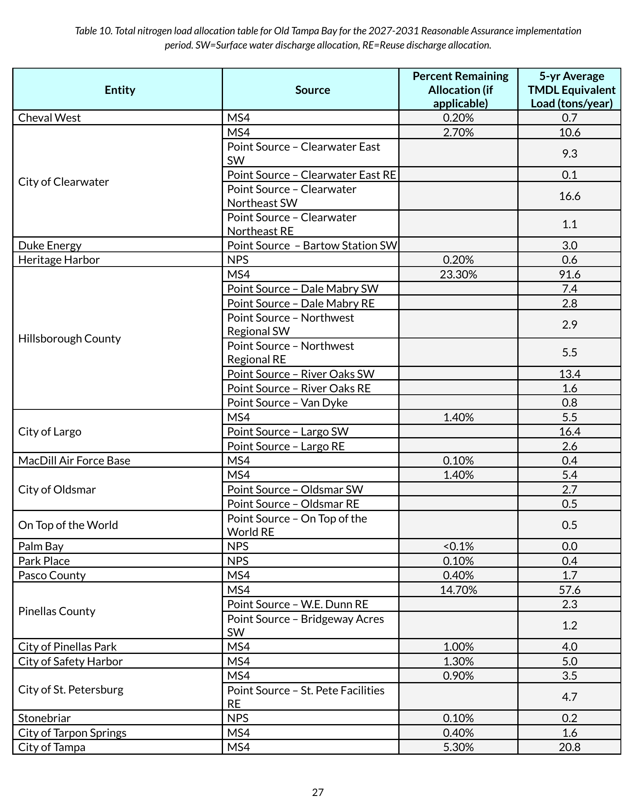
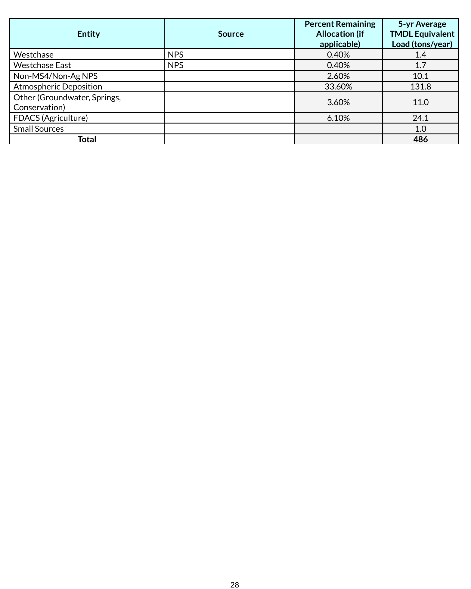
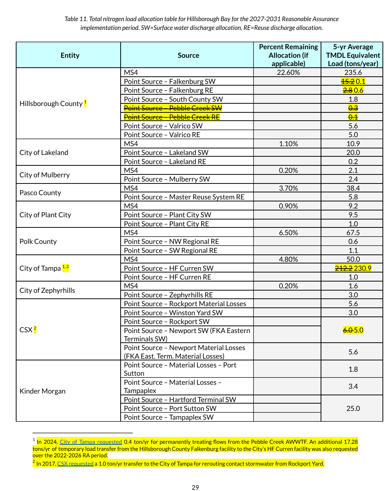
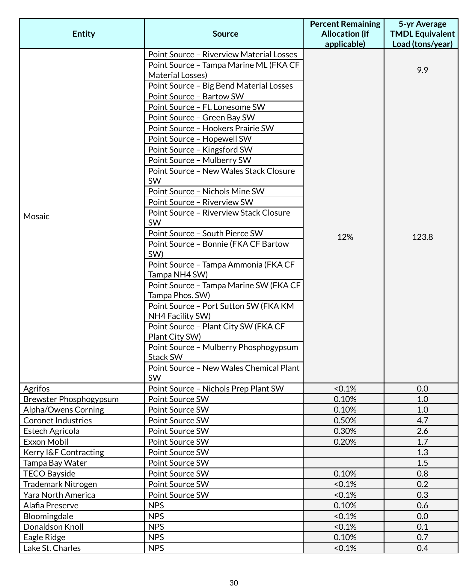
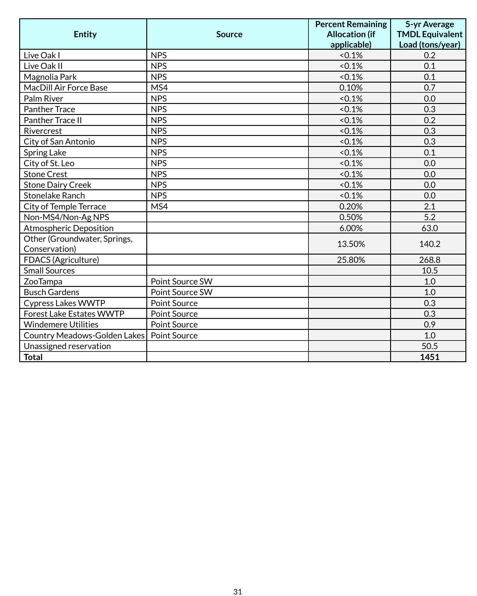
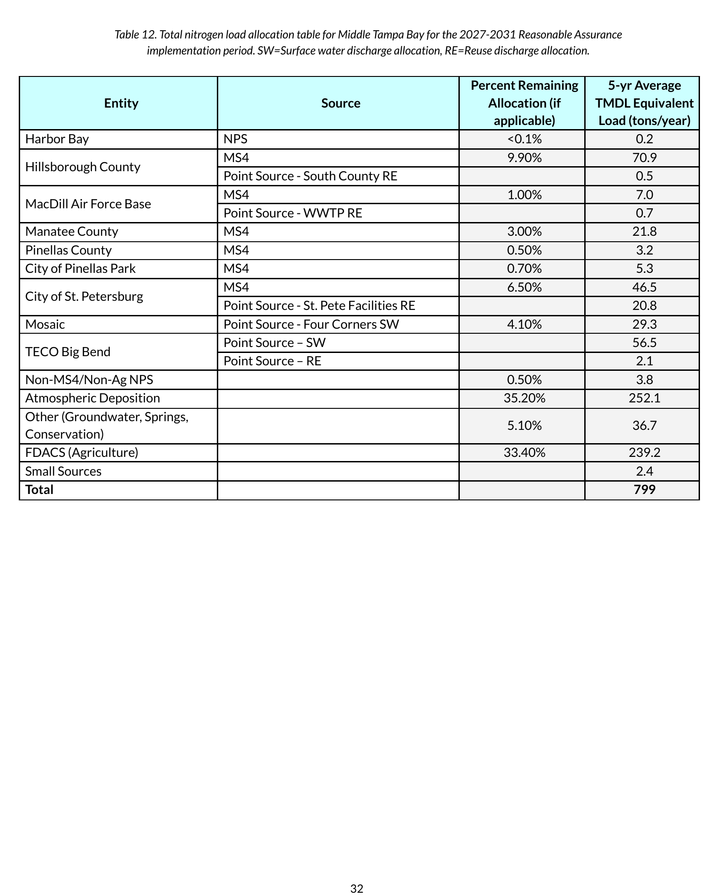
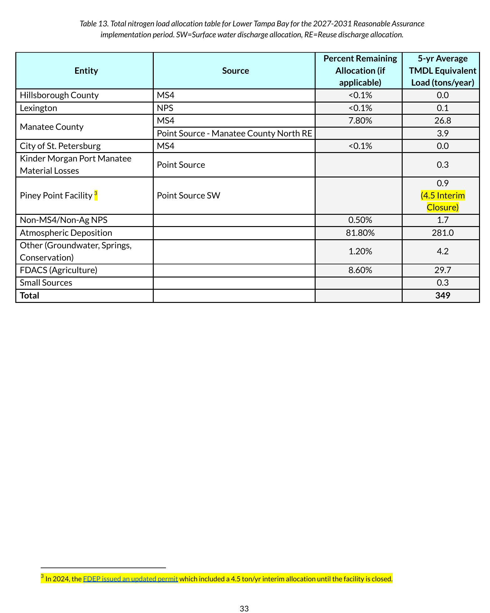
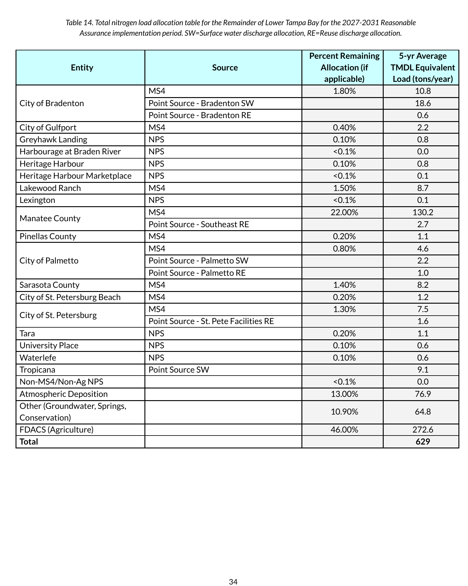

This chapter reproduces the Action Plan Database project tables (**Tables 7–9**, Section 3.b) and the
entity TN load allocation tables for the 2027–2031 implementation period (**Tables 10–14**, Section
3.f) exactly as they appear in the 2027 Reasonable Assurance Update. Click any table to enlarge.

::: {.callout-note appearance="simple"}
These tables are reproduced as images from the submitted RA Update to preserve the exact entity names,
allocation percentages, and load figures. The underlying project records live in the online
[Tampa Bay Action Plan Database](https://apdb.tbep.org); allocation figures derive from the
[`tbep-tech/load-estimates`](https://github.com/tbep-tech/load-estimates) pipeline and the Consortium's
entity-load workbooks.
:::

# Tables 7–9. Action Plan Database projects (Section 3.b)

These tables are rendered natively from the current Tampa Bay Action Plan Database export
(`APDB_Tables_as_of_2026-11`). TN load reductions are in lbs/yr unless noted.

```{r}
#| label: apdb-tables
#| results: asis
library(flextable)
library(here)

show_apdb <- function(csv, title, note = NULL) {
  d <- read.csv(here("data", csv), check.names = FALSE)
  for (col in names(d)) d[[col]][is.na(d[[col]])] <- ""
  cat(sprintf("\n\n## %s\n\n", title))
  if (!is.null(note)) cat(note, "\n\n")
  ft <- flextable(d)
  ft <- bg(ft, bg = "#BDD7EE", part = "header")
  # bold subtotal / total rows (first column contains 'Subtotal' or 'Total')
  key <- names(d)[1]
  tot <- grepl("Subtotal|Total", d[[key]])
  if (any(tot)) ft <- bold(ft, i = which(tot), part = "body")
  ft <- fontsize(ft, size = 8, part = "all")
  ft <- border_outer(ft); ft <- border_inner_h(ft, part = "body")
  ft <- set_table_properties(ft, layout = "autofit", width = 1)
  flextable_to_rmd(ft)
  cat("\n\n")
}

show_apdb("table7_completed.csv",
  "Table 7. Completed load-reduction projects, 2022–2025",
  "Cumulative completed-project TN reduction: **66,267 lbs/yr (33.1 tons/yr)**.")
show_apdb("table8_ongoing.csv",
  "Table 8. Ongoing and education projects")
show_apdb("table9_future.csv",
  "Table 9. Future planned projects (post-2026)")
```

::: {.callout-note appearance="simple"}
Combined anticipated future TN offset from ongoing and planned projects (Tables 8 & 9):
**106.78 tons/yr** at an estimated cost of **$137,428,003**.
:::

# Tables 10–14. Entity TN load allocations, 2027–2031 (Section 3.f){#tbl-alloc}

SW = Surface water discharge allocation; RE = Reuse discharge allocation.

## Table 10. Old Tampa Bay

{fig-alt="Table 10 Old Tampa Bay allocations page 1"}

{fig-alt="Table 10 Old Tampa Bay allocations page 2"}

## Table 11. Hillsborough Bay

{fig-alt="Table 11 Hillsborough Bay allocations page 1"}

{fig-alt="Table 11 Hillsborough Bay allocations page 2"}

{fig-alt="Table 11 Hillsborough Bay allocations page 3"}

## Table 12. Middle Tampa Bay

{fig-alt="Table 12 Middle Tampa Bay allocations"}

## Table 13. Lower Tampa Bay

{fig-alt="Table 13 Lower Tampa Bay allocations"}

## Table 14. Remainder of Lower Tampa Bay

{fig-alt="Table 14 Remainder of Lower Tampa Bay allocations"}
